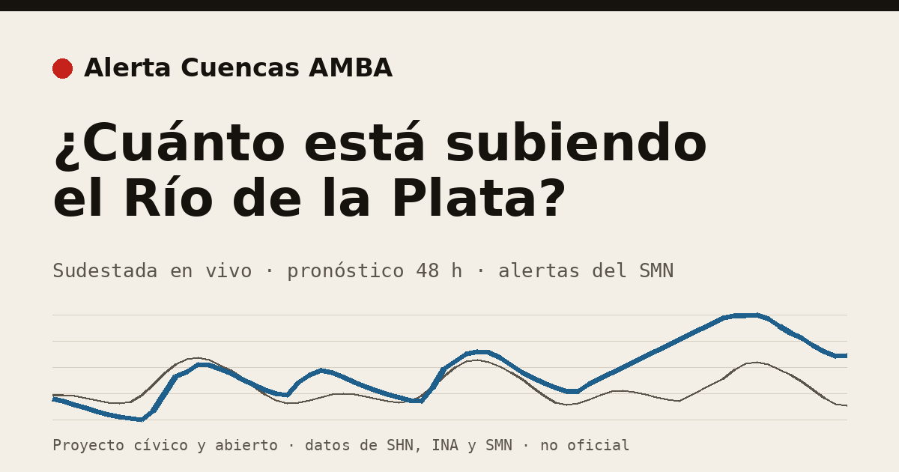

# Alerta Cuencas AMBA

**El Río de la Plata y las cuencas del AMBA, en vivo y en criollo.**

Monitoreo cívico, abierto y sin fines de lucro para saber **cuánto está subiendo el agua**
en el Delta, la costa y las cuencas del AMBA. Junta en un solo lugar datos públicos que hoy
están dispersos entre Hidrografía Naval, el INA y el SMN, y los muestra pensados para el
celular de quien vive cerca del agua.

> ⚠️ **No es un sistema oficial.** Ante una emergencia seguí siempre a SMN, Hidrografía Naval
> y Defensa Civil. Este proyecto traduce sus datos; no los reemplaza.



**Web en vivo:** <https://eroveda.github.io/alerta-cuencas-amba/>

---

## Por qué existe

- La temporada de **El Niño 2026-27** suele traer más lluvia y crecidas del Paraná, que se
  suman a las sudestadas.
- En el Delta y la costa (Tigre, San Fernando, Quilmes, Avellaneda) miles de familias
  necesitan saber con horas de anticipación cuánto va a subir el agua.
- **Los datos ya existen.** Hidrografía Naval mide el río cada hora, el INA lo pronostica y el
  SMN emite alertas. Pero están en planillas técnicas, separados por organismo y no pensados
  para un celular.

Lo que suele fallar en las inundaciones no es el dato: es la **última milla**, traducirlo y
hacerlo llegar a tiempo.

## Qué hace hoy

- **Sudestada en vivo:** cuánto está el río por encima de la marea astronómica en San
  Fernando, Buenos Aires y La Plata, con un gráfico de 72 h y el pronóstico del INA a 48 h.
- **Tablero por cuenca:** alertas oficiales del SMN cruzadas con cada cuenca, el arroyo
  Medrano y la lluvia observada en 6 aeropuertos.
- **Funciona solo, 24/7 y gratis:** GitHub Actions consulta las fuentes cada 10 minutos y
  publica la web en GitHub Pages. No depende de ninguna computadora prendida.

Hoy está en **Fase 0, monitoreo**: muestra datos, **no envía avisos**. Ver [Hoja de ruta](#hoja-de-ruta).

## Fuentes

Todo sale de datos públicos.

| Fuente | Qué aporta | Módulo |
|---|---|---|
| SMN (alertas CAP) | Alertas oficiales con polígono, cruzadas con las cuencas | `alertas/fuentes/smn_cap.py` |
| Hidrografía Naval (SHN) | Altura del Río de la Plata y **sudestada** (medido − marea astronómica) | `alertas/fuentes/shn.py` |
| SNIH | A° Medrano en el reservorio Tecnópolis | `alertas/fuentes/snih.py` |
| METAR (NOAA AWC) | Lluvia y tormenta en 6 aeropuertos, asignadas a las cuencas a ≤10 km | `alertas/fuentes/metar.py` |
| INA a5 | Pronóstico probabilístico en San Fernando (+48 h) | `alertas/fuentes/ina.py` |

El relevamiento completo de fuentes, incluidas las que **faltan** y habría que pedir que se
abran, está en [`docs/fuentes/`](docs/fuentes/README.md).

## Cómo leer los datos

- La **sudestada** es la diferencia entre lo que mide el río y lo que marcaría la marea sola.
  Es una observación, no un pronóstico de inundación.
- El mapa muestra las alturas **sin clasificarlas contra umbrales** hasta confirmar con el SHN
  la conversión entre planos de referencia (ver [Pendientes](#pendientes-conocidos)).
- El vocabulario es de **observación** ("el río está X m sobre la marea"). Nunca "alerta roja"
  ni los colores del SMN, para no confundirse con un aviso oficial.

## Correrlo en tu máquina

Requiere Python 3.12+ y [uv](https://docs.astral.sh/uv/).

```bash
git clone https://github.com/eroveda/alerta-cuencas-amba && cd alerta-cuencas-amba
uv sync
.venv/bin/python -m alertas.cli zonas   # arma web/data/zonas.geojson
scripts/monitor.sh                      # consulta las fuentes cada 5 min y sirve el mapa
```

Mapa en <http://127.0.0.1:8790> (otro puerto: `PUERTO=8791 scripts/monitor.sh`).

Tests (74, cobertura 91 %):

```bash
.venv/bin/pytest --cov --cov-report=term-missing
```

Los tests de cada fuente usan respuestas reales guardadas en `tests/fixtures/`, así que
corren sin internet.

## Cómo está armado

```
alertas/
  fuentes/      un módulo por fuente: parse() puro + obtener()
  registro.py   las fuentes disponibles; el CLI no se toca al sumar una
  estaciones.py qué estaciones se consultan
  zonas.py      geometría de las cuencas
  estado.py     arma estado.json, el contrato con la web
  serie.py      la serie de 72 h para el gráfico
  db.py         historia de 30 días en SQLite
web/            página estática (HTML + JS, sin build)
```

El contrato entre el monitoreo y la web está en
[`docs/contrato-estado.md`](docs/contrato-estado.md).

## Cómo sumarse

Se puede aportar sin programar.

- **¿Vivís en el Delta o en la costa?** Contanos qué te sirve y qué no. Es lo que más falta.
- **¿Conocés una fuente de datos?** Lluvia medida en tiempo real, Riachuelo, Reconquista,
  radar: abrí un issue con el link.
- **¿Programás?**
  - Una **estación** de un tipo que ya existe (SHN, SNIH, METAR): una línea en `alertas/estaciones.py`.
  - Una **fuente nueva:** un módulo en `alertas/fuentes/` con `parse` (función pura, probada con
    un archivo de ejemplo) y `obtener`, registrado en `alertas/fuentes/registro.py`.
  - Un **campo en el mapa:** respetando [`docs/contrato-estado.md`](docs/contrato-estado.md).

Más detalle en [`CONTRIBUTING.md`](CONTRIBUTING.md).

## Hoja de ruta

| Fase | Qué | Estado |
|---|---|---|
| 0 | Monitoreo de todas las cuencas, sin avisos: el **tablero abierto** | **en curso** |
| 1 | Avisos de sudestada (Costa/Delta) en **modo prueba**, comparados contra lo que pasó | pendiente: datum SHN |
| 2 | Avisos públicos a través de **referentes** del Delta y la costa | pendiente |
| 3 | Sostenibilidad: alianzas e incidencia por la apertura de datos | pendiente |

Las cuencas pluviales (Medrano, CABA) quedan en el tablero, sin avisos. El diseño de la
Fase 1 está en [`docs/diseno-fase1.md`](docs/diseno-fase1.md).

## Pendientes conocidos

- **Datum:** confirmar con el SHN la conversión entre el plano de reducción (lecturas) y el
  cero del Riachuelo (umbrales).
- **Zona horaria de SNIH:** validar con un evento conocido.
- **Costa/Delta** es una geometría provisoria (incluye Sarandí y La Plata).
- Falta **lluvia medida en tiempo real** en CABA.

## Licencia

Código bajo licencia [MIT](LICENSE). Los datos pertenecen a cada organismo de origen.
